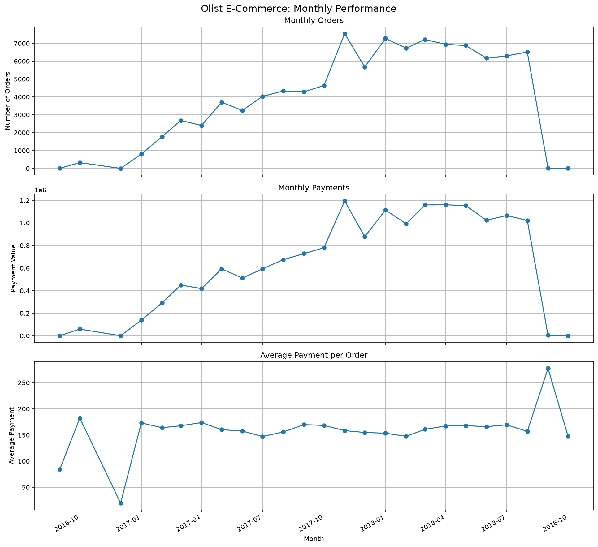

# Olist E-Commerce Data Analysis

## Project Overview

This project analyzes the Brazilian E-Commerce Public Dataset by Olist using Python, PostgreSQL, and SQL.

The main goal is to explore monthly e-commerce performance, analyze payment trends, and calculate the average payment value per order.

## Tech Stack

- Python 3.13
- PostgreSQL
- SQL
- Pandas
- SQLAlchemy
- Matplotlib
- Jupyter Notebook
- Git

## Dataset

The project uses the [Brazilian E-Commerce Public Dataset by Olist](https://www.kaggle.com/datasets/olistbr/brazilian-ecommerce).

The original CSV files are not included in this repository. Download the dataset from Kaggle and place the files in `data/raw/`.

## Project Structure

```text
olist-ecommerce-data-project/
├── data/
│   └── raw/
├── notebooks/
│   └── inspect_data.ipynb
├── reports/
│   ├── analysis_notes.md
│   ├── monthly_orders.png
│   ├── monthly_payments.png
│   ├── average_payment_per_order.png
│   └── monthly_performance_dashboard.png
├── sql/
│   ├── 01_create_tables.sql
│   └── 02_data_analysis.sql
├── src/
│   ├── inspect_data.py
│   ├── check_data_quality.py
│   └── visualize_monthly_metrics.py
├── .gitignore
├── requirements.txt
└── README.md
```

## Database

The PostgreSQL database is named `olist_ecommerce`.

Seven tables were created:

| Table | Description |
|---|---|
| customers | Customer information |
| orders | Order details and timestamps |
| products | Product attributes |
| sellers | Seller information |
| order_items | Items included in orders |
| order_payments | Payment information |
| order_reviews | Customer reviews |

Primary keys, composite primary keys, and foreign key constraints were defined to maintain data integrity.

## Data Quality Checks

The following checks were performed:

- Row count verification
- Primary key uniqueness
- Composite key uniqueness
- Foreign key integrity
- Duplicate record inspection

All foreign key checks returned zero unmatched records.

The `order_reviews` table uses a composite primary key (`review_id`, `order_id`) because `review_id` alone is not unique.

### Imported Record Counts

| Table | Rows |
|---|---:|
| customers | 99,441 |
| orders | 99,441 |
| products | 32,951 |
| sellers | 3,095 |
| order_items | 112,650 |
| order_payments | 103,886 |
| order_reviews | 99,224 |

## Analysis

Three monthly metrics were calculated:

1. Monthly number of orders.
2. Total payment value per month.
3. Average payment value per order per month.

For the average payment metric, payment records are first aggregated by order. The monthly average is then calculated from order-level totals.

This prevents orders with multiple payment records from being counted as separate orders.

## Key Findings

- November 2017 had the highest number of orders: 7,544.
- November 2017 also had the highest monthly payment total: 1,194,882.80.
- April 2018 recorded 6,939 orders and 1,160,785.48 in payments.
- Average payment per order was 158.39 in November 2017 and 167.28 in April 2018.
- September 2018 had the highest average payment per order (277.47), but only 16 orders were recorded. This result should be interpreted with caution.

## Dashboard

The dashboard combines all three monthly metrics.



## Setup and Execution

### 1. Clone the repository

```bash
git clone <YOUR_GITHUB_REPOSITORY_URL>
cd olist-ecommerce-data-project
```

### 2. Create and activate a virtual environment

```powershell
python -m venv .venv
.\.venv\Scripts\Activate.ps1
```

### 3. Install dependencies

```powershell
pip install -r requirements.txt
```

### 4. Download the dataset

Download the CSV files from Kaggle and place them in `data/raw/`.

### 5. Create the PostgreSQL database

Create a database named `olist_ecommerce`.

Execute:

```text
sql/01_create_tables.sql
```

### 6. Import the CSV files

Import the CSV files into PostgreSQL using pgAdmin in the following order:

1. customers
2. products
3. sellers
4. orders
5. order_items
6. order_payments
7. order_reviews

### 7. Run the visualization script

```powershell
python src/visualize_monthly_metrics.py
```

Enter your PostgreSQL username and password when prompted.

The dashboard will be saved to `reports/monthly_performance_dashboard.png`.

## Limitations

- CSV files are imported manually through pgAdmin. The project does not currently implement a fully automated ingestion pipeline.
- Some months at the beginning and end of the dataset contain very few orders. This may indicate incomplete dataset coverage.
- Payment value represents recorded payment amounts and should not automatically be interpreted as net revenue.
- Monthly averages based on very small numbers of orders should be interpreted with caution.

## Author

Personal portfolio project in data analytics and engineering.